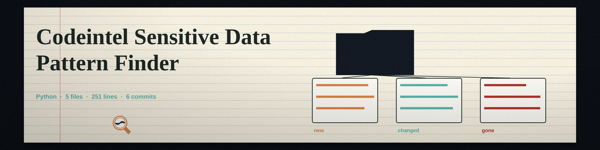

# codeintel-Sensitive-Data-Pattern-Finder
Scans codebase for patterns resembling sensitive data (e.g., credit card numbers, social security numbers, API keys) using regular expressions and configurable pattern lists. Reports potential leaks and flags high-risk areas. - Focused on Tools for static code analysis, vulnerability scanning, and code quality assurance

## Install
`git clone https://github.com/ShadowGuardAI/codeintel-sensitive-data-pattern-finder`

## Usage
`./codeintel-sensitive-data-pattern-finder [params]`

## Parameters
- `-h`: Show help message and exit
- `-p`: No description provided
- `-e`: No description provided
- `-r`: Scan directories recursively.
- `-l`: No description provided
- `-o`: Path to an output file. The file is replaced at the start of each run, so it holds only that run's results, not matches from earlier runs.

## Exit code
A run exits 1 when a named path is missing, when any named file or any file in a scanned directory could not be read, or when any pattern fails to compile. Matches that were found are still reported before the run exits.

## License
Copyright (c) ShadowGuardAI
