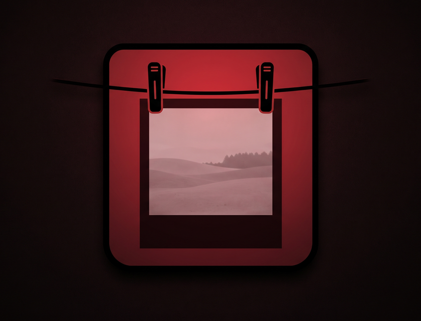

Forecast entry slip: the title below is set in Betania Patmos in indigo on a star white slip, ruled as a forecast entry with a date rule under the name. One small sundog plate sits under the banner only; headings after that stay typographic.

# codeintel-Sensitive-Data-Pattern-Finder

Scans codebase for patterns resembling sensitive data (e.g., credit card numbers, social security numbers, API keys) using regular expressions and configurable pattern lists. Reports potential leaks and flags high-risk areas. - Focused on Tools for static code analysis, vulnerability scanning, and code quality assurance

## Install
`git clone https://github.com/ShadowGuardAI/codeintel-sensitive-data-pattern-finder`

> **Forecast slip, flagged in place.** The install line above uses ShadowGuardAI without a hyphen. It does not use ShadowGuard-AI. It is preserved exactly as printed and flagged here, never silently fixed. The README gives one clone line only, and no next step.

## Usage
`./codeintel-sensitive-data-pattern-finder [params]`

> **Forecast slip: README Usage Names No Path.** The usage line above is a placeholder. It names no path. The parser takes one or more paths, each required, each a file or a directory, and multiple paths are allowed in one run.

## Parameters
> **Forecast slip: The Match Stands in Clear.** This finder prints the match itself, in clear, to console, to the warning log, and to the output file if one is named. It does not mask. That behaviour is stated here as a fact only; no matched value is shown anywhere in this document.

- `-h`: Show help message and exit
- `-p`: No description provided

> **Forecast slip: Three Settings Left Blank.** The patterns flag, the exclude flag, and the log level flag are each left as No description provided in the README. Their code accounts sit on the website only, and the two are kept apart, as the scene direction orders.
- `-e`: No description provided
- `-r`: Scan directories recursively.
- `-l`: No description provided
- `-o`: Path to an output file. The file is replaced at the start of each run, so it holds only that run's results, not matches from earlier runs.

## Exit code
A run exits 1 when a named path is missing, when any named file or any file in a scanned directory could not be read, or when any pattern fails to compile. Matches that were found are still reported before the run exits.

## License
Copyright (c) ShadowGuardAI

> **Forecast slip, flagged in place.** The closing line above reads Copyright (c) ShadowGuardAI, the same unhyphenated fault as the clone line. It is preserved exactly as printed, and no licence name is added, because the README gives none.
